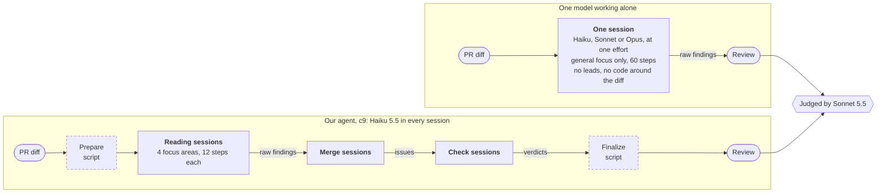

# Full benchmark results

## Summary for directors

We built an AI agent that reviews code changes, and tested it on ReviewBench, a public benchmark of 219 real code changes. **If entered, it would place 2 of 22, just behind the leader, OhMyBug, and at low cost. It isn't ahead yet:** it finds slightly fewer known issues, and more of its comments are wrong. These results are unofficial, since the agent hasn't been submitted. All work on it is paused.

| | Our agent | OhMyBug, the leader |
|---|---:|---:|
| Overall score | 67.6 | 69.3 |
| Known issues found | 57.1% | 60.2% |
| Comments that were right, ours estimated from a sample | 86.1% | 92.4% |
| Time per code change | 5 min 40 s | 5 min 22 s |
| Cost per code change, at list prices | At least $0.38 | Not published |

**What we learned:**

- **A more capable AI model finds no more, and costs far more.** On a small test, the same agent found about the same number of issues on all three models, while the most capable one cost about 23 times as much as the low-cost one. They don't all find the same ones: 29 of the 54 known issues were found by all three, and 47 by at least one.
- **To find more, the agent has to look differently.** In a detailed trace on part of the benchmark, it missed 598 known issues, and no reviewer in the agent ever raised 544 of them.
- **Wrong comments are the biggest gap.** The step that challenges findings removed only 370 of 6,626 possible issues, and never reached 2,445, mostly in the largest changes.

**Decisions needed:**

1. **Should we allow a stronger model for the challenge step?** This is the most direct way we see to cut wrong comments. It departs from the goal of using only the low-cost model, and we roughly estimate it would raise the cost to about $0.60 per code change. That hasn't been measured. We recommend testing it, which uses little of the usage allowance.
2. **Should the work resume?** The next steps are to finish testing a sharper challenge step, then rerun the full benchmark, which takes about 11 hours and about 11% of the weekly usage allowance. We recommend resuming. The gap is small enough to be worth closing, though we can't promise that it will close.

**How far to trust this:** we score with a newer AI judge than the benchmark uses, and nobody has measured how much that changes the results. Our score is from one run and the leader's is an average of three. The model test covers only a few code changes. The cost is what the usage would cost at list prices, not what we paid. The version tested here is a candidate, and the agent in the repository is still an older one.

Everything below is technical detail for the engineering team. Here, c9 is our agent's current version, precision and recall are the scoring terms for "right" and "found", and F1 is the overall score.

## Technical detail

Each full run over ReviewBench's 219 PRs goes here, newest first. [How to run one](LOOP.md#running-a-full-benchmark).

Every score on this page is judged by Claude Sonnet 5.5. The leaderboard judges with Sonnet 5, so these are not leaderboard scores, and comparing them with a leaderboard row carries an offset nobody has measured. Full runs include `val` and `holdout`, so this page reports aggregates only.

## `full-c9-1`, 2026-11-04

**It does not match OhMyBug yet.** Grounded precision is level, and grounded recall is 3 points short. Augmented precision is 6 points short, which is the clearest gap. Time is level with OhMyBug's slowest run.

The candidate is `c9-few` (fingerprint `4221b3dcb7`), reviewed by Haiku 5.5 through the Claude Code CLI. **This is not what `skill/` ships.** The gate rejected c9 for taking 347 seconds per PR against a 330 limit, so `skill/pr-review` is still the older champion (`c8e50defc8`), which has never had a full run. [The patch from one to the other](results/c9-few.patch), [the aggregates as JSON](results/full-c9-1.json).

### How c9 works

c9 isn't a model. It is candidate 9 of this review agent, a set of prompts, settings and scripts, and every model session in it runs Haiku 5.5. Scripts do what can be done exactly, and short sessions do what needs judgment.

```mermaid
flowchart LR
    PR([PR diff]) --> Prepare["<b>Prepare</b><br/>script<br/>split the diff, skip<br/>generated files, collect leads"]
    Prepare -->|"parts of the diff, leads"| reading
    subgraph reading["Reading sessions: Haiku 5.5 at high effort, for each part of the diff"]
        direction TB
        G1["General"]
        G2["General, a second time"]
        I["Intent, once for the whole PR"]
        D["Drift"]
        F["Failure paths"]
    end
    reading -->|"12,417 raw findings"| Group["<b>Group similar findings</b><br/>script"]
    Group --> Merge["<b>Merge sessions</b><br/>Haiku 5.5<br/>are these the same issue?"]
    Merge -->|"6,626 issues"| Check["<b>Check sessions</b><br/>Haiku 5.5, 6 issues at a time<br/>try to disprove each one"]
    Check -->|"verdicts"| Final["<b>Finalize</b><br/>script<br/>drop what was disproved"]
    Final -->|"7,269 comments"| Out([Review])
    classDef script stroke-dasharray: 5 4
    class Prepare,Group,Final script
```



Dashed boxes are scripts and solid boxes are model sessions. The counts are totals across all 219 PRs. There are more comments than issues because a problem spanning several files gets a comment in each.

- **Sessions per PR.** It averages 7.6 reading, 7.1 merging and 10.9 checking sessions across the full run. A small PR has one part, so it gets 5 reading sessions, and a large one is split into up to 10 parts, with at most 16 reading sessions in all.
- **What each one does.** `General` is an exhaustive sweep, and runs twice because a second sample finds different things. `Intent` asks whether the PR does what it claims, and what it removed. `Drift` covers tests, docs and consistency. `Failure paths` covers errors, concurrency, performance and security.
- **Reading sessions are short and focused.** Each has a budget of 12 steps, read-only tools and no shell, and is given the code around its part of the diff.
- **Checks need evidence.** A session that calls a finding wrong has to quote the code that shows it, and a script confirms the quote exists. If it doesn't, the finding stays, as `uncertain`.
- **One deadline for the whole PR.** It is 420 seconds plus 30 per 1,000 lines changed, up to 480. Reading has to finish by 65% of it, merging by 72% and checking by 97.5%. A session running at its stage's cutoff is stopped, and an issue nobody checked stays in as `unverified`.
- **How it differs from the skill in the repo.** The skill runs up to 11 focus areas, and c9 runs 4, with `general` twice. c9 also adds a new rule for dismissing findings, sets discovery to high effort, and turns off a pass over hunks nobody commented on. [The full patch](results/c9-few.patch).

What the checking stage did to those 6,626 issues:

| Verdict | Issues | Share | What happens |
|---|---:|---:|---|
| Confirmed | 3,619 | 55% | Kept |
| Never checked, out of time or over the limit | 2,445 | 37% | Kept |
| Uncertain | 192 | 3% | Kept |
| Not worth raising | 250 | 4% | Dropped |
| Disproved | 120 | 2% | Dropped |

So this stage drops under 6% of issues, and over a third never reach it. 89% of those are on PRs of 2,000 lines or more.

### Against OhMyBug

| | c9, Haiku 5.5 | OhMyBug run 1 | Run 2 | Run 3 |
|---|---:|---:|---:|---:|
| Grounded precision | 82.8 | 81.9 | 81.9 | 81.2 |
| Grounded recall | 57.1 | 60.1 | 60.2 | 60.2 |
| Grounded F1 | 67.6 | 69.3 | 69.4 | 69.1 |
| Augmented precision | 86.1 | 92.5 | 92.7 | 92.0 |
| Augmented recall | 82.6 | 85.5 | 85.8 | 84.8 |
| Augmented F1 | 84.3 | 88.8 | 89.1 | 88.3 |
| Novel yield | 62.1 | 71.7 | 72.5 | 70.7 |
| Comments (candidates) | 7,269 | 8,057 | 8,341 | 7,973 |
| Novel true positives | about 4,980 | 6,093 | 6,382 | 6,034 |
| Mean time per PR | 340s | 339s | 313s | 315s |
| PRs finished | 219 | 219 | 219 | 219 |

If it were entered, c9 would rank 2 of 22 on grounded F1, 3 on high-severity F1 and 2 on augmented F1, counting each leaderboard configuration as an entry. It hasn't been submitted, so these aren't leaderboard places.

OhMyBug's figures are from the ReviewBench leaderboard (site data is CC BY-NC 4.0). Grounded scores for c9 are macro-averaged over PRs, as the leaderboard's look to be, though that isn't confirmed. Pooled instead, they are P 84.7, R 56.2, F1 67.6.

Reasons to be careful with this table:

- **The judges differ**, as above.
- **Augmented scores here are an estimate**, from classifying 822 sampled findings out of 5,683 unmatched ones. 87.6% of them were true (95% interval 85.2 to 89.7). OhMyBug's are from full classification.
- **Sonnet 5.5 isn't simply a harsh judge here.** Opus 5.5 at max effort re-classified a balanced sample of its labels, and answered 88 of 100. It agreed with 39 of the 44 findings Sonnet called true, and overturned 15 of the 44 it called false, using about 14 tool calls per finding. Weighted back, the share of unmatched findings that are true is 81.9% (95% interval 73.5 to 90.3) against Sonnet's 87.6%, which would make augmented P 82.1, R 82.0, F1 82.0. Sonnet is the working judge and Opus the audit, so neither replaces the other, and this doesn't measure Sonnet 5. To reach OhMyBug's augmented precision on Sonnet's scale, about 96% of unmatched findings would have to be true.
- **This is one run, not three.** Resampling PRs gives 95% intervals of P 79.9 to 85.6, R 54.4 to 59.8, and F1 65.3 to 69.9. So the lead on grounded precision is noise, the F1 gap is within the interval, and the recall gap is just outside it. The interval does not cover the difference between judges.
- **The reviewers differ.** OhMyBug's vendor describes two independent Opus 5.5 reviewers. c9 runs Haiku 5.5, at an estimated $0.38 per PR. OhMyBug's cost isn't published, so the table has no cost row.

### Where the scores come from

By severity:

| Severity | Macro P | Macro R | Macro F1 | Golden findings covered |
|---|---:|---:|---:|---:|
| High | 90.8 | 66.4 | 76.7 | 105 of 181 |
| Medium | 92.8 | 70.1 | 79.9 | 621 of 891 |
| Low | 76.5 | 48.8 | 59.6 | 748 of 1,551 |

The leaderboard's high-severity row for OhMyBug is R 75.6, P 92.0, so high-severity recall is about 9 points short. With so few high-severity findings it swings easily: redoing 6 PRs moved it from 68.0 to 66.4.

By split:

| Split | PRs | P | R | F1 | Comments per PR | Mean time | Cost per PR |
|---|---:|---:|---:|---:|---:|---:|---:|
| `train` | 114 | 81.2 | 55.6 | 66.0 | 31.8 | 338s | $0.39 |
| `val` | 22 | 88.9 | 60.4 | 71.9 | 39.5 | 345s | $0.41 |
| `holdout` | 74 | 83.6 | 56.9 | 67.7 | 35.9 | 355s | $0.39 |
| `val_siblings_unused` | 9 | 83.1 | 71.2 | 76.7 | 13.6 | 255s | $0.14 |

`holdout` scores above `train`, so there is no sign that c9 overfits the PRs it was designed from.

By lines changed:

| Lines | PRs | P | R | F1 | Comments per PR | Mean time | Cost per PR | Verify tasks lost |
|---|---:|---:|---:|---:|---:|---:|---:|---:|
| Under 100 | 38 | 77.8 | 65.3 | 71.0 | 10.8 | 233s | $0.11 | 0 of 143 |
| 100 to 300 | 41 | 84.0 | 55.8 | 67.1 | 15.2 | 271s | $0.15 | 2 of 223 |
| 300 to 800 | 47 | 79.5 | 53.8 | 64.2 | 21.1 | 328s | $0.22 | 13 of 368 |
| 800 to 2,000 | 42 | 83.4 | 56.7 | 67.5 | 34.2 | 383s | $0.41 | 82 of 484 |
| 2,000 and up | 51 | 88.2 | 55.4 | 68.1 | 74.6 | 450s | $0.90 | 932 of 1,520 |

### Where the gap is

- **Volume.** c9 writes 33.2 comments per PR, and OhMyBug about 37. Across the leaderboard, recall follows `-2.9 + 17.3 * ln(comments per PR)`, which predicts 57.7 at c9's volume. c9 scores 57.1, so it finds about what its volume predicts and has no lead there.
- **False alarms.** The estimated share of unmatched findings that are false is 12.4%. That is what holds augmented precision at 86.1, and it is why novel yield falls short too. Before the full sample, a reading from 31 PRs had this at 6%. The Opus audit gives no reason to blame the judge for this, and it found both kinds of disagreement: findings Sonnet rejected as not worth raising though they were factually right, and findings Sonnet accepted that the code contradicts.
- **Low-severity findings** are 1,551 of the 2,623 golden findings, with recall of only 48.8, and precision of 76.5.
- **The checking stage drops little.** Under 6% of issues are dropped, and 37% are never checked, which [the table above](#how-c9-works) shows. A sharper check is the most direct way to remove false alarms.
- **Verification on large PRs.** 61% of verify tasks on PRs of 2,000 lines or more never finish, and unverified candidates are kept. These PRs still have the highest grounded precision, so the verifier's value there needs a controlled test before more time goes to it. Lost sessions don't clearly explain missed findings either. On 43 `train` PRs, PRs of 300 to 2,000 lines had the same recall with and without lost discovery sessions (50.2 and 50.0). Above 2,000 lines the difference was larger (60.0 and 52.3), but on only 14 PRs. What remains is probably findings no lens ever reported, which hasn't been traced across `train` yet.

### c9 against each model working alone

To see what the model and its effort setting are worth, each Claude model also reviewed PRs alone, in a single session, and was judged the same way. A result named "Sonnet high" is Sonnet 5.5 at `high` effort, which sets how much thinking and checking it does before answering.



These aren't bare models. Each session gets the reading prompt and the general focus from the skill in the repo, but nothing else from the pipeline. A truly bare prompt hasn't been run. [c9 with each model](#c9-with-each-model) runs the pipeline itself on Sonnet and Opus.

| | c9 | One model alone |
|---|---|---|
| Model | Haiku 5.5 | Haiku, Sonnet or Opus |
| Effort | High for reading, default for the rest | One setting, from low to max |
| Sessions per PR on these PRs | About 16 | 1 |
| Prompts | c9's own | From the skill in the repo |
| Focus | General twice, intent, drift, failure paths | General only |
| Merges duplicates | Yes | No |
| Checks findings against the code | Yes | No |
| Time limit | One deadline per PR | None in practice |

All on the same 4 `train` PRs, with 54 golden findings, judged by Sonnet 5.5:

| Reviewer | P | R | F1 | High-severity F1 | Cost per PR | Mean time |
|---|---:|---:|---:|---:|---:|---:|
| **c9 on Haiku 5.5** | 93.0 | 73.6 | 82.2 | 83.3 | $0.187 | 324s |
| Sonnet alone, max | 90.3 | 65.4 | 75.9 | 85.0 | $1.696 | 647s |
| Opus alone, max | 87.7 | 65.6 | 75.0 | 74.1 | $2.902 | 770s, from an earlier run |
| Haiku alone, max | 88.7 | 61.2 | 72.5 | 78.9 | $0.436 | 673s |
| Sonnet alone, high | 90.6 | 54.1 | 67.8 | 75.7 | $0.192 | 82s |
| Opus alone, medium | 92.7 | 52.4 | 66.9 | 75.7 | $0.393 | 89s |
| Haiku alone, high | 90.8 | 52.5 | 66.6 | 78.9 | $0.066 | 198s |
| Sonnet alone, medium | 97.2 | 48.0 | 64.3 | 72.9 | $0.128 | 58s |
| Opus alone, high | 91.0 | 49.4 | 64.0 | 75.7 | $0.606 | 113s |
| Sonnet alone, low | 91.7 | 35.8 | 51.5 | 63.9 | $0.025 | 25s |
| Haiku alone, medium | 94.4 | 23.4 | 37.6 | 51.7 | $0.016 | 83s |

Read this as a direction, not a ranking:

- **These PRs flatter the top setups.** They were picked for size spread and golden count, after their earlier scores had been seen. On the original 8 PRs, c9 scores F1 73.7 and Opus alone at max 69.0.
- **Runs swing widely.** Haiku at medium scored 56.8 on these same PRs in an earlier run, and 37.6 here, so only large gaps mean anything.
- **It isn't a like-for-like test of models.** c9 uses different prompts and many sessions, so this shows Haiku inside a pipeline against each model alone. The prompt for models alone also asks how each finding was found, which adds some output.

What it suggests: c9 costs about what one Sonnet session at high effort costs, and finds more. Max effort is the only setting that clearly lifts a model alone, and it takes over 10 minutes per PR.

To repeat a row, using the PRs in [the data file](results/model-comparison.json):

```sh
python3 bench/teacher.py run --who sonnet-high --select KEYS --name cmp-sonnet-high --at-once 4
```

### c9 with each model

The same pipeline, prompts, deadlines and effort settings, with one model in every session. On the same 4 `train` PRs, judged by Sonnet 5.5, one model at a time:

| c9 on | P | R | F1 | High-severity F1 | Golden found | Comments per PR | Cost per PR | Mean time | Unmatched findings true |
|---|---:|---:|---:|---:|---:|---:|---:|---:|---:|
| Haiku 5.5, full run | 93.0 | 73.6 | 82.2 | 83.3 | 39 of 54 | 21.0 | $0.187 | 324s | 87.6% over all 219 PRs |
| Haiku 5.5, second run | 88.1 | 71.5 | 78.9 | 93.3 | 39 of 54 | 24.5 | $0.173 | 236s | 86.7% (70 to 95) |
| Sonnet 5.5 | 87.8 | 69.9 | 77.8 | 89.5 | 38 of 54 | 14.8 | $1.511 | 147s | 91.7% (74 to 98) |
| Opus 5.5 | 94.3 | 72.0 | 81.7 | 78.3 | 39 of 54 | 20.2 | $3.958 | 202s | 96.4% (82 to 99) |

- **A stronger model doesn't raise recall here.** Every model finds 38 or 39 of the 54 golden findings, so buying a stronger model doesn't buy more recall. They differ in which ones they find: all three found 29, and at least one found 47. Two Haiku runs share 36 and together reach 42, so different sessions reach different findings, and different models somewhat more.
- **It may lower false alarms.** The true rate rises from Haiku to Sonnet to Opus, in line with OhMyBug's use of Opus. Each estimate rests on about 30 findings, and the intervals overlap, so this is a lead to test and not a result.
- **It costs far more.** Sonnet costs about 9 times as much as Haiku here, and Opus about 23 times.
- **Sonnet is the fastest, and time depends on what runs alongside.** Sonnet takes 147 seconds. The two Haiku runs of the same PRs took 324 and 236 seconds. The first ran beside other PRs in the full run, and the second ran with only these PRs on the machine.

### Time and cost

Reviews ran from 07:40 to 18:11, and judging finished at 18:35. Reviewing 6 PRs again and judging those took until 18:58. Mean time is over the 202 PRs with clean timing, leaving out those listed under [what disturbed the run](#what-disturbed-the-run) that weren't reviewed again. All 219 together average 337 seconds.

Cost is what Claude Code reports at API rates, since this account is on a subscription. It's a floor, because a session killed at a deadline never reports its cost. The total is $83.27, or $0.380 per PR, with these shares:

| Stage | Tasks | Not finished | Share of cost | Cost per task | Mean task time |
|---|---:|---:|---:|---:|---:|
| Discover | 1,668 | 166 (10%) | 87% | $0.044 | 185s |
| Dedupe | 1,603 | 116 (7%) | 1% | $0.0007 | 18s |
| Verify | 2,738 | 1,029 (38%) | 12% | $0.0037 | 80s |

"Not finished" counts tasks that failed, were skipped, or were cut off. Judging is separate, and came to at least $84 at API rates, nearly all of it classifying unmatched findings. Judging partway through the run isn't in that figure. The run moved the account's weekly meter from 47% to 58%, including this session's own use.

### Making it cheaper and faster

The goal before this run was to cut cost and time by choosing lenses and sessions better, while keeping quality. c9 made these changes:

| Change | Evidence |
|---|---|
| Turned off the `quick`, `config` and `ui` lenses | Replaying discovery showed they lose at most 2 golden findings. Further cuts trade quality for cost about 1 to 1 |
| Ran lenses by priority, under a limit of 16 discovery tasks | `general` first, with 2 passes, then `intent`, `drift`, `failure` |
| Set discovery effort to `high`, and left dedupe and verify unset | The effort study below |
| Sessions return when they answer (the champion has this too) | Claude Code runs on for up to minutes after its `result`, which used to count against the PR |
| A new verifier rule | A controlled test on identical discovery favored it |

**Effort.** One session per PR on 8 `train` PRs, judged by Sonnet 5.5:

| Effort | P | R | F1 | High-severity F1 | Cost per PR | Output tokens |
|---|---:|---:|---:|---:|---:|---:|
| `medium` | 86.5 | 41.5 | 56.1 | 64.3 | $0.038 | 21k |
| `high` | 91.7 | 54.6 | 68.4 | 90.2 | $0.083 | 44k |
| `max` | 89.4 | 56.4 | 69.2 | 85.1 | $0.504 | 161k |

`high` is the best value. `max` costs 6 times as much for under a point of F1. `xhigh` wasn't tried, and a lower effort for verification still needs a controlled test.

**PRs at once.** Three at once was tried for part of the run, and made every size slower. Time for PRs under 100 lines went from 210 to 297 seconds, and the share of PRs under 2,000 lines losing sessions went from 3 of 33 to 5 of 13. [Measuring time](LOOP.md#measuring-time) has what is known about why.

**The outcome is unconfirmed.** On 25 PRs, c9 was 13% faster and 10% cheaper than the champion, with a better F1 (319s against 368s, $0.35 against $0.39, F1 74.2 against 71.2). The full run came in above that estimate, at 340s and at least $0.380, but the champion has no full run, so the difference at full scale isn't known. The speed target isn't met: 340s is slower than all three of OhMyBug's runs, though only 1 second behind the slowest.

### Readings that did not hold

Partway through this run, some early readings were reported that the full run contradicted:

- **"Tied on F1."** At 148 PRs, F1 was 69.7. PRs run in alphabetical order, so repositories cluster, and the last 71 PRs scored 62.8. Don't call a partial run.
- **"The gap is coverage, not false alarms."** That came from 31 PRs where 94% of unmatched findings were true. The full sample says 87.6%.
- **"Lost sessions on large PRs are what costs recall."** 43 `train` PRs gave no clear support for this.
- **The projection of 321 seconds and $0.35 per PR,** which came from the 25 PRs. Those PRs flatter c9 in general: F1 was 74.2 on them, and 67.6 on all 219.

### What disturbed the run

- **Timing probes.** A burst of 20 sessions, run next to the live benchmark to investigate slow starts, pushed 2 PRs into their deadlines at a cost of 21 tasks. Nothing heavy should run next to a timed run.
- **Three at once.** 18 PRs ran under that test. 4 of them were under 2,000 lines and still lost tasks.
- **Restarts.** 5 PRs were interrupted and resumed, so they replayed finished tasks from the cache, and their times are too low.

The 6 PRs most affected, the first 2 and those 4, were reviewed again with a new salt, and those reviews replaced the originals. This moved the totals by about 0.1 point. The other 14 PRs from the three-at-once test, and the 5 replayed PRs, keep their scores but are left out of timing.

### What comes next

Design only from `train` PRs:

1. Sample false alarms on `train`, and find what they have in common. This is the largest gap, and costs recall nothing if it's done well.
2. Trace missed findings on all 114 `train` PRs with `loop/diagnose.py`, focusing on low severity and on PRs of 300 to 800 lines, where recall is lowest.
3. Test with controlled replays whether verification earns its time on large PRs, and whether verifying at `low` effort loses anything.
4. Run the champion in full too, so that there is a real baseline for cost and time.
5. Run again in full when a candidate clearly beats c9 on `train` and `val`. Each full run also looks at `holdout`, so these should stay rare, and `holdout` shouldn't choose between candidates.

### Reproducing it

Rebuild the candidate from `skill/pr-review` at commit `87245d5`:

```sh
mkdir -p loop/work/c9-few && cp -R skill/pr-review loop/work/c9-few/
(cd loop/work/c9-few && patch -p1 -E < ../../../docs/results/c9-few.patch)
```

Then run it:

```sh
python3 bench/run.py --select all --name full-c9-1 --skill-dir loop/work/c9-few/pr-review --host claude --model claude-haiku-5-5 --prs-at-once 2 --concurrency 24 --salt full1 --classify-sample 4 --max-usage 85
```

Model samples will differ, so expect scores within the intervals above, not the same scores.
